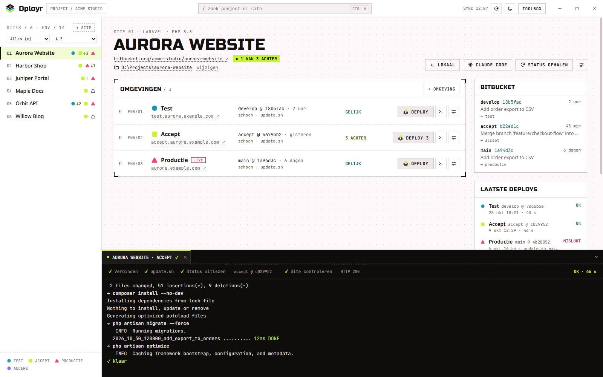
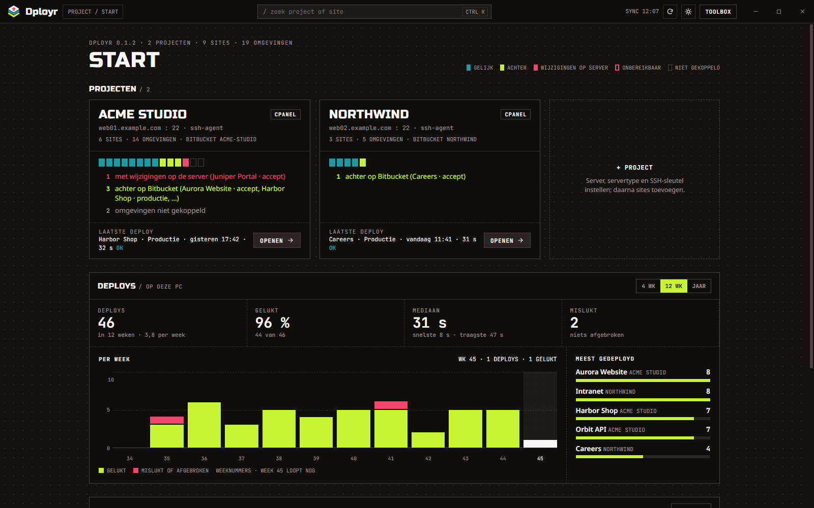

<div align="center">


# Dployr

**Deploy je sites over SSH, per site en omgeving.**

[](https://github.com/punneke/dployr/releases/latest)
[](https://github.com/punneke/dployr/releases)
[](#installeren)
[](https://tauri.app)
[](#bijwerken)

[dployr.nl](https://dployr.nl) · [Installeren](#installeren) · [Releases](https://github.com/punneke/dployr/releases)

</div>

<br>

<picture>
  <source media="(prefers-color-scheme: dark)" srcset="docs/site-dark.png">
  
</picture>

Dployr is een Windows-app voor sites op je eigen webservers. Per site en omgeving (test,
accept, productie) zie je wat er op de server staat en wat Bitbucket nieuwer heeft. Je
deployt met een preview vooraf en volgt de uitvoer live.

## Wat Dployr doet

- **Overzicht per omgeving.** Welke branch en commit er op de server staat, hoeveel commits
  Bitbucket voorloopt, en of er bestanden op de server zijn aangepast.
- **Deployen met een preview.** Vooraf zie je welke commits en bestanden meegaan. Staan er
  wijzigingen op de server, dan gaat de deploy niet door. Daarna volg je de stappen live,
  tot en met een controle of de site antwoordt.
- **Je eigen `update.sh`.** De deploy draait het script uit de repository van de site:
  composer, migraties en caches doe je zoals de site dat nodig heeft.
- **Terminals.** Eén klik voor een terminal op de server, in de map van de site. Of lokaal
  in je eigen checkout: Git Bash, PowerShell of Claude Code.
- **cPanel zoals het is.** Werkt met je bestaande cPanel-accounts, één gebruiker per
  omgeving. Dployr haalt de accounts op en zet je SSH-sleutel erop.
- **Niemand ertussen.** Geen server of dienst van Dployr: de app praat zelf met je servers
  en met Bitbucket, met je eigen SSH-sleutel.



<sub>Het startscherm: je projecten, hoe hun omgevingen ervoor staan en je deploys per week.
De screenshots tonen demogegevens.</sub>

## Installeren

In PowerShell:

```powershell
irm https://dployr.nl/install.ps1 | iex
```

Het script ([install.ps1](install.ps1)) haalt de nieuwste release op, controleert de
installer tegen `SHA256SUMS.txt` en installeert Dployr voor jouw gebruiker, zonder
beheerdersrechten. Dployr staat daarna in het Start-menu.

Of download `Dployr_<versie>_x64-setup.exe` zelf van de
[releases-pagina](https://github.com/punneke/dployr/releases/latest) en start hem. De
installer is (nog) niet met een certificaat ondertekend, dus Windows SmartScreen meldt
"Windows heeft uw pc beschermd". Kies **Meer info** en dan **Toch uitvoeren**.

## Bijwerken

Dat doet Dployr zelf: bij het starten en daarna elk uur kijkt de app of er een nieuwe
versie is, downloadt die en installeert hem pas als de handtekening klopt. Je kiest zelf
wanneer ("Bijwerken en herstarten" in de Toolbox), of het gebeurt bij de volgende start.

## Over deze repository

Deze repository bevat alleen de releases: de installer, zijn handtekening, `latest.json`
voor de updater en `SHA256SUMS.txt`. De broncode is privé.
